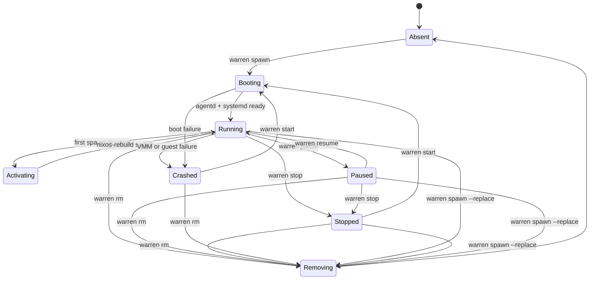
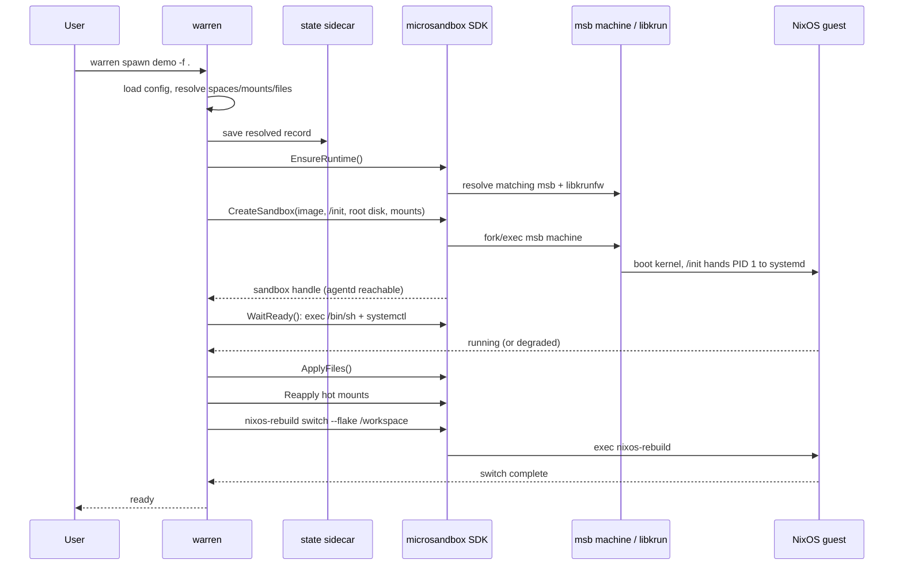
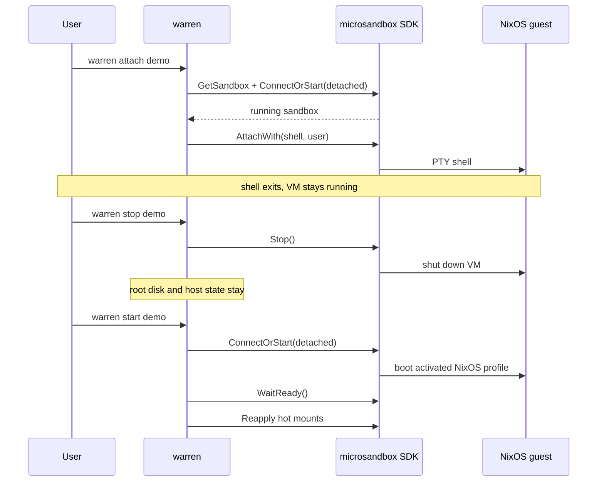
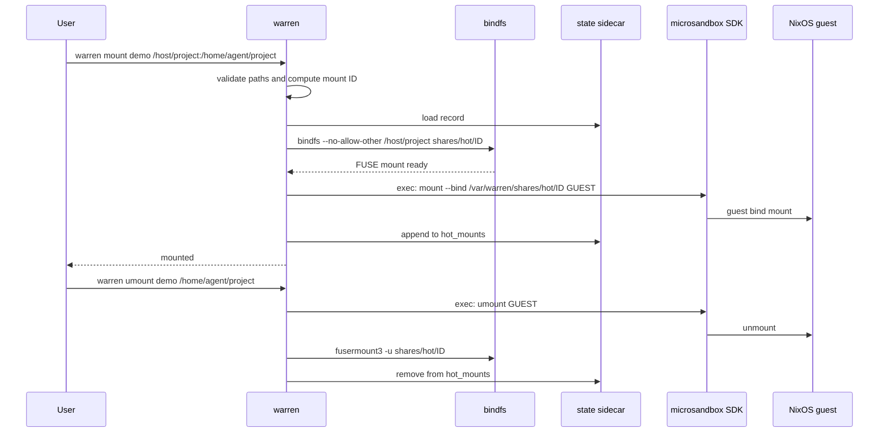

# VM lifecycle

warren is a thin lifecycle layer over microsandbox. The SDK owns the VM
process and its disk; warren owns the saved config, the flake activation, and
the hot-mount intent.

## State machine



Notes:

- `Absent → Booting` also covers `warren spawn` reusing a stopped sandbox:
  microsandbox starts it through `ConnectOrStart`.
- `Activating` is a warren phase, not a microsandbox status. It runs
  `nixos-rebuild switch --flake /workspace#HOST` inside the guest.
- `warren attach` does not change state. It only connects to a running VM.
- `warren stop` keeps the managed root disk and the host `persist`/`shares`
  directories.
- `warren rm` force-destroys a running sandbox after tearing down hot mounts.
- microsandbox also has `created`, `starting`, and `draining` states; warren
  normally surfaces `running`, `paused`, `stopped`, and `crashed`.

## `warren spawn`



The VM is created detached, so closing the CLI does not stop it.

If the named sandbox already exists and is activated, `spawn` reuses it and
skips `nixos-rebuild` unless `--eval` is passed. `--replace` destroys the old
sandbox and creates a new one.

## Day-2 operations



`run`, `cp`, `mount`, `logs`, `pause`, `resume`, and `attach` require a
running VM. `start` requires a stopped or crashed VM.

## Hot mount lifecycle



The host path is exposed through one pre-mounted share root:

```text
host path
  → bindfs at <state>/<name>/shares/hot/<id>
  → microsandbox in-process virtio-fs at /var/warren/shares
  → guest bind mount at GUEST
```

After `warren start`, every desired hot mount is recreated from
`hot_mounts` in the sidecar. `warren stop` leaves host staging in place;
`warren rm` unmounts both sides before deleting the state directory.
